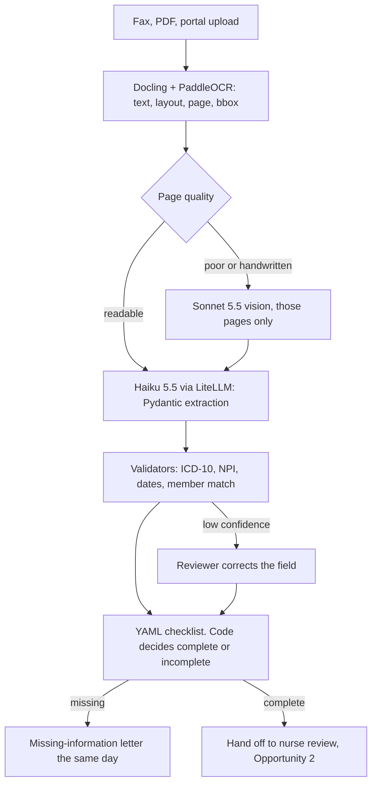

# Opportunity 1: Intelligent intake and completeness check

Read every fax on day 0. Tell the provider what is missing. Do not decide coverage.

This is the prototype. It is the fastest to build (about 1–2 weeks), it needs no licensed criteria, and a messy page in / clean checklist out is the right thing to put on a screen for 5 minutes.

Backup plan: `opp1_intake_completeness_b3de1620.plan.md`.

## Problem

Documents arrive by fax, PDF, portal, and upload. Staff index and key them by hand. Of 15,000 requests a month, 22% (about 3,300) go back for missing information, usually after a nurse has already waited in a queue to discover the gap. That round trip sits inside a 4.2-day turnaround, and CMS-0057-F's 72-hour and 7-day clocks apply to fax too.

## What AI does

The model extracts facts and points at the page they came from. Deterministic code decides whether the packet is complete.

1. Parse the packet to text, layout, page number, and bounding boxes.
2. Score each page. Clean pages go to Claude Haiku 5.5. Poor or handwritten pages go to Claude Sonnet 5.5 vision, and only those pages.
3. Haiku fills a fixed schema: member, provider, CPT, ICD-10, level and laterality, pain duration, conservative care, imaging, baseline pain or function score, and whether this is a repeat injection.
4. Validators check ICD-10 shape, NPI (Luhn), dates, and member match against the plan's master patient index. A weak member match goes to a person. A wrong match is a privacy incident.
5. A versioned YAML checklist for one policy says which facts must be present. The demo policy is CMS LCD L39240, Epidural Steroid Injections for Pain Management (revision effective April 16, 2026). The intake items taken from that LCD are: history and exam, concordant imaging, a baseline pain or function score, at least four weeks of pain plus four weeks of failed conservative care (or a documented inability to tolerate it), and, for a repeat injection, at least 50% relief lasting at least three months.
6. If anything required is missing, a Jinja letter goes to the provider the same day. The letter asks for documents. It is not a denial.
7. A reviewer sees the page, the fields, the confidence, the checklist, and the dollar cost of that request. Low-confidence fields are edited by a person before the packet moves on.

The LLM never returns "complete" or "incomplete" as a decision. Rerunning the checklist is free.

## Architecture

Production parsing is Docling (MIT) with PaddleOCR (Apache-2.0), because it keeps the page and the box. The prototype may use PyMuPDF for speed. PyMuPDF is AGPL, so it does not ship to production. Textract Detect Document Text ($0.0015 a page) is an optional fallback. Textract Analyze Document ($0.05 a page, about $11k a month here) is not the default.

Workflow in the demo is a Python script. Production pends use Temporal: request info, wait, resume, and do not lose the CMS clock. FHIR comes next, not in the demo: a Da Vinci PAS-shaped `Claim` posted to HAPI FHIR once the packet is complete.

## Impact

Assumptions are labeled as such.

- Indexing queue, about 0.7 of the 4.2 days, comes off the clock.
- Rework target: 22% down to 10% or less.
- Intake time: 5–10 minutes of keying down to under 2 minutes of checking low-confidence fields. That is about 1,250–2,500 hours a month, about $37k–$75k at $30 an hour.
- This opportunity alone is about 17% of the 40% turnaround reduction leadership asked for. It also stops incomplete charts from ever reaching the nurse, which is what keeps Opportunity 2's token bill down.

External, vendor-reported, directional only: Autonomize has cited 76% intake automation; Lateetud has cited 70% straight-through processing on a large fax volume.

## Cost

Bedrock in-region list prices, October 2026. Haiku 5.5 is $0.11 / $0.55 per million tokens. Sonnet 5.5 is $2.20 / $11. Assume 15 pages, and assume we send parsed text rather than page images except on the vision fallback.

| Step | Sketch | About |
| --- | --- | --- |
| Classify | 2k in / 0.2k out, Haiku | $0.0003 |
| Extract | 20k in / 2.5k out, Haiku | $0.004 |
| Map to the checklist | 8k in / 1k out, Haiku | $0.001 |
| Text-only subtotal | | about $0.01 |
| Vision, 20% of packets, ~3 pages | Sonnet, ~$0.045 on those packets | about $0.01 blended |

Monthly at 15,000 requests: about $300–$800 if Haiku goes first, or $1.5k–$3k if every packet is read by Sonnet. A 50-packet demo with prompt iteration is under $20.

Haiku prompts over 100k tokens jump to $0.55 / $2.75 per million. Split the packet. Do not paste a 30-page OCR dump into one call.

## Compliance

- No PHI until the AWS BAA is signed. PrivateLink to Bedrock. Minimum necessary. An audit event when a packet is accepted or sent back. Presidio on traces. The prototype's public API key sees synthetic, watermarked pages only.
- The checklist is versioned and signed off by a clinician when the policy changes. The model does not invent new requirements.
- Member matching uses a high threshold. Borderline pairs go to a person.
- This step does not approve or deny. Sending a letter that says "denied" from this system would be a compliance failure, not a product feature.

## Limits

- Fax OCR sets the accuracy ceiling. Mitigation: vision on bad pages, a confidence score on every field, a person on anything shaky. A 2026 fax-distortion study is the reason the vision path exists: heavy fax noise can cut extraction quality sharply, and the image degrades less than OCR-then-LLM.
- A complete packet is not a medically necessary service. Four weeks of physical therapy can be present and still fail clinical review. That is Opportunity 2's job.
- Checklists drift if nobody owns them. One owner per service line, and a diff when the LCD is revised. L39240's current revision date is April 16, 2026.
- The demo is one service line. The second line is a new YAML file, not a new model.

## What we measure

Missing-item recall is the metric that matters. Marking an incomplete packet complete is the expensive mistake. Target 95% or better. Also field-level F1 on clean, faxed, and handwritten packets, member-match precision at 99.9% or better, and p50 / p95 dollars per request.
