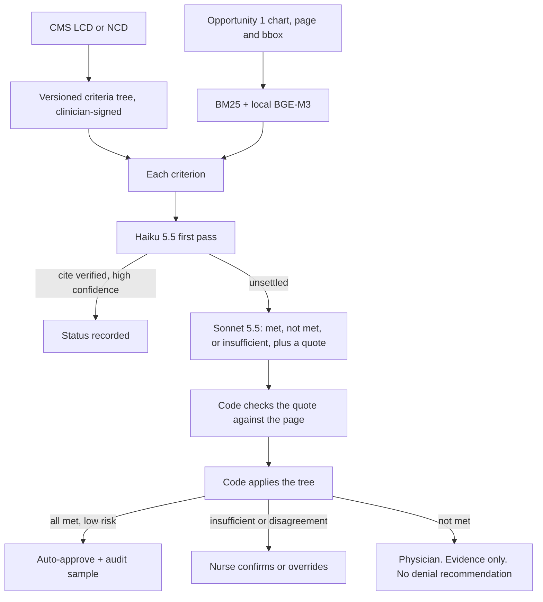

# Opportunity 2: Nurse clinical decision support

Put the evidence for each criterion on one screen, with the page it came from. Let code apply the policy's AND/OR logic. Let a nurse confirm. Let a physician make every adverse decision.

This is the opportunity the CMO cares about most, and it is the one we build second. It needs a clinician-signed criteria tree and an evaluation set, so it is the wrong thing to fake in a 15-minute demo. It is also where the token spend lives.

Backup plan: `opp2_nurse_decision_support_8e565158.plan.md`.

## Problem

On a complete packet, a nurse still reads 10–30 pages to find the line that satisfies each rule. Nurse queue plus review is about 2.2 of the 4.2 days (assumption). The risk in automating that reading is well known: appeals overturn a large share of Medicare Advantage denials (KFF: 80.7% in 2024), and CMS has already said an algorithm cannot be the denial.

## What AI does

The model answers one question per criterion: met, not met, or insufficient, and it must quote the chart. It does not compute the policy, and it does not recommend a denial.

1. A clinician turns the public LCD into a versioned tree: criterion id, text, AND/OR, the kind of evidence that counts, and the source paragraph. Haiku can draft the tree. A nurse signs it. The demo tree is LCD L39240 (lumbar epidural steroid injection). A useful second tree with obvious "not met" cases is knee arthroscopy, NCD 150.9. Home sleep testing (LCD L36861) is the alternate. GLP-1 drugs stay out: drugs are outside the CMS-0057-F prior-auth timelines.
2. Opportunity 1 has already parsed the chart with page numbers and boxes. We embed those chunks locally (BGE-M3) and retrieve the passages relevant to each criterion. We retrieve from the chart. We do not retrieve from the policy. The policy is fixed.
3. Haiku 5.5 takes a first pass. If the citation checks out and confidence is high, that criterion is done.
4. Sonnet 5.5 judges the unsettled criteria and returns a quote, a page, a rationale, and a confidence. A second and third sample happen only when the two models disagree or confidence is low.
5. A citation checker (fuzzy match of the quote against the cited page) runs in code. A failed match downgrades the criterion to insufficient.
6. Code walks the tree and produces the result. Three routes follow:
   - All met, low-risk service, no disagreement, no red flags: auto-approve, and audit a 5–10% sample.
   - Anything insufficient, or the models disagree: the nurse decides from the evidence panel.
   - Anything not met: nurse, then physician. The screen shows the quote. It does not show a recommended denial. Texas SB 815 reaches adverse determinations made "wholly or partly" by an automated system, so the wording on that screen is a legal choice, not a UX detail.
7. "Insufficient" is a real answer. It routes back to the missing-information path from Opportunity 1 instead of being forced into met or not met.

InterQual and MCG are how a commercial plan would encode criteria in production, through the vendor's API. Those texts do not go in a repository, a vector store, or a demo. Carelon's policies explicitly restrict AI reuse. Do not scrape Aetna, United, or EviCore.

## Architecture

LangGraph runs the demo and pauses for the nurse. Production UI is the UM workbench (React and assistant-ui), not a side tool nurses have to open. Postgres full-text search plus pgvector, fused, is the index. Cohere Rerank is optional (about $2 per 1,000 queries; skip it unless the evaluation set says retrieval is the failure). Opus 5.5 is the offline judge for hard cases and for grading the system. It is not on the live path.

## Impact

Assumptions are labeled as such.

- About 1.0 day off the 4.2.
- 30–50% less nurse time per case that still needs a person.
- 20–30% of volume is the candidate pool for auto-approval. Approval only.
- About 2,500 nurse hours a month, about $137k at $55 an hour. That is the capacity story: growth without a requisition.
- Case mix will shift. Easy cases leave the queue, and the remaining cases are harder. Track minutes per case by tier or the average will lie.

Anchors, directional: Elevance has described two-thirds of electronic prior auths completing in real time. Blue Shield of California has described AI that approves or routes and does not deny. A JMCP 2026 review of the evidence is still thin and argues for a human plus model, by risk tier. That is the design here.

## Cost

This opportunity can be cheap or wasteful, and the difference is the design. Bedrock in-region, October 2026. Sonnet 5.5 is $2.20 / $11 per million. Cache reads are $0.11 per million. Assume 8 criteria and 15,000 complete cases a month. Incomplete packets from Opportunity 1 never get this far.

| Design | Per case | Per month |
| --- | --- | --- |
| Naive: 8 criteria × 3 Sonnet samples | $0.30–$0.70 | $4.5k–$10.5k |
| Optimized: Haiku first, Sonnet on the unsettled slice, policy cached, extra samples on ~20% | $0.08–$0.20 | $1.2k–$3k |
| Worked example: one Sonnet call, 2k cached policy + 10k evidence + 2.5k output, plus extra samples on 20% | about $0.07–$0.10 | about $1.1k–$1.5k |

Output tokens are a large share of the Sonnet bill. The schema asks for a short quote, not an essay. The full 30-page chart stays in the index. The prompt gets the retrieved chunks.

A dollar cap per case in Langfuse is part of the design, not a finance afterthought.

## Compliance

- CMS-4201-F and the February 6, 2024 FAQ: the decision rests on the individual record. Criteria stay the published criteria. Bias gets monitored.
- CMS-0057-F: a denial needs a specific reason. The per-criterion quotes are the raw material for a letter a physician actually writes.
- State laws: California SB 1120; Texas SB 815 ("wholly or partly"); Maryland HB 820 ("deny, delay, or modify"); also Nebraska, Arizona, Washington, Alabama. Counsel reviews the words "partly" and "delay" before auto-approval is switched on. NCQA does not allow AI-only medical-necessity denials, and does not allow AI on appeals. URAC UM v8.2 has a standard for selecting AI in utilization review.
- FDA clinical decision support guidance (January 2026): a payer coverage tool is likely administrative. Citations still have to let the clinician check the basis without trusting the model.
- HIPAA as in the overview: BAA, PrivateLink, pinned model IDs so a silent upgrade cannot change clinical behavior.
- Gold-card exemptions (Texas HB 3459 / HB 3812; California SB 306 from 2028) are checked at intake, before any of this runs.
- Rollout order is the control: retrospective scoring, then silent shadow for 4–6 weeks, then assistive, then limited auto-approval only after the positive predictive value of "all met" clears the bar below.

## Limits

- A quote that is not on the cited page is a hallucination. The checker downgrades it to insufficient. The nurse sees the miss.
- Nurses believe a confident panel. Seed wrong suggestions in the audit and watch the override rate. If overrides go to zero, the audit is failing.
- Nurse-to-nurse agreement is the ceiling. Measure it before claiming the model "matches clinicians." Cohen's kappa is a poor summary when about 95% of cases are approvals; Gwet's AC1 is the more stable number. The gate for auto-approval is the positive predictive value of "all met": the lower bound of a 95% Wilson interval at about 98% or better, which takes on the order of 750 cases in that tier. Sensitivity for "not met" and "insufficient" targets 95% or better. Quote-to-page match targets above 99%. Error rates by age, sex, race, and region stay within about 5 points of each other.
- An LLM-as-judge grading this system is advisory. Published agreement between model judges and clinicians is not good enough to replace the labeled set.
- This opportunity does nothing for a packet that is missing the MRI. Opportunity 1 runs first.
