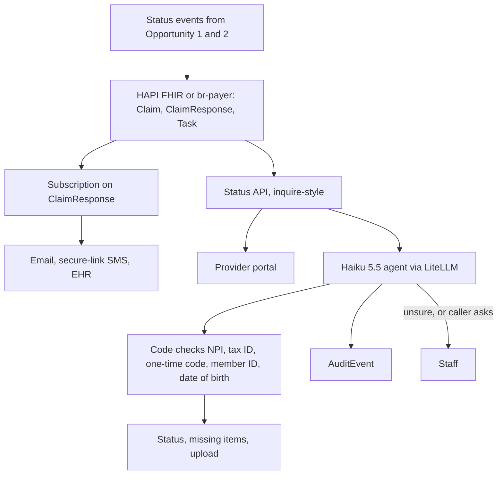

# Opportunity 3: Provider status transparency

Tell the provider where the request is, what is missing, and when it was decided, without a phone queue. The agent reads status and accepts documents. It does not touch the decision.

This ranks second for speed to a prototype (about 1–2 weeks, fully synthetic) and last for the CMO's clinical question. It is an architecture slide in the 15-minute talk, and a follow-up demo if operations asks.

Backup plan: `opp3_provider_transparency_8d8612ab.plan.md`.

## Problem

Providers call because the portal is incomplete and the fax disappeared into a queue. Assumption: 1–2 status calls per request, so 15,000–30,000 calls a month. At $5–$7 a call that is on the order of $75k–$210k a month, and it pulls the same people who should be reviewing charts. Payer hold times average about 8.5 minutes (Infinitus, January 2026). AHIP still has a large share of prior auths arriving on paper, so the phone does not go away on its own.

CMS-0057-F makes the status path mandatory anyway: a Prior Authorization API and a Provider Access API by January 1, 2027, prior-auth status on the Patient Access API within one business day, and a specific reason on every denial since 2026. Proposed rule CMS-0062-P points at Da Vinci PAS 2.2.1 and CDex 2.1. Build to those.

## What AI does

Very little, on purpose. The useful product is a status record and a notification. The model is a thin conversational layer on top.

1. Opportunity 1 and Opportunity 2 write status events into FHIR: a PAS `Claim` (`use` = preauthorization), a `ClaimResponse`, and a Task when information is missing.
2. A subscription fires when the `ClaimResponse` changes. The provider gets email, a secure link by SMS, a fax only where a fax is still the system of record, or an EHR notification. The message body has no clinical detail.
3. A portal (and, later, `Claim/$inquire`) answers the same question the phone tree answers.
4. A LangGraph agent on Claude Haiku 5.5 handles "where is my auth?" in chat. Before any tool that can see a member runs, code checks the caller: organization NPI plus tax ID plus a one-time code to a registered contact, and member ID plus date of birth plus name. The model never decides whether someone is allowed to see the record. The Da Vinci IG itself warns that member ID plus NPI is a weak control, so the extra factors are required.
5. After the gate, the only tools are: get status, list missing items, and accept an attachment (CDex `$submit-attachment`). A low-confidence turn or an explicit request for a person is a warm transfer.
6. A denial response reads back the reason the physician already wrote, plus the appeal path. The agent does not re-explain medical necessity.
7. Every lookup, failed login, and disclosure writes a FHIR `AuditEvent`, kept six years.

Voice is a later channel. Humana's provider voice agent (live since 2019, on the order of 7,000 calls a day) is the existence proof. It is also where TCPA, two-party consent, and speech-to-text errors show up. Chat first.

## Architecture

HAPI FHIR or the HL7 Da Vinci br-payer reference server. Medplum is the other open-source option if we want subscription-triggered bots. The Microsoft FHIR server is a poor fit here because subscriptions are not really available. Identity is Keycloak. SMART Backend Services covers system-to-system. Notifications can be Novu or Apprise; the demo inbox is Mailpit.

Three synthetic scenarios are enough for a follow-up demo: "where is my auth?" returns pended, missing the PT note, and accepts the upload; a decision sends the secure-link email; a denial reads the specific reason and offers a warm transfer.

## Impact

- Deflect 50–70% of status calls once the portal and chat are actually good. That is about $50k–$100k a month plus on the order of 800 staff hours, at the call-cost assumption above.
- Missing-information response time falls from days to hours, worth about 0.1–0.2 days of turnaround. This is the smallest slice of the 4.2 days. Its value is capacity and the 2027 API deadline, not the turnaround headline.
- Provider satisfaction is the soft metric. Call volume, handle time, and hours from "we need the MRI" to "the MRI arrived" are the hard ones.

## Cost

Haiku 5.5 at $0.11 / $0.55 per million tokens. A short chat is about 16k input and 1.2k output tokens, about $0.0025. At 20,000–30,000 conversations that is about $50–$75 a month, call it $40–$150 with longer threads. Cache the tool list and the system prompt. Do not paste the chart into a status bot.

| Channel | Monthly, this volume | Notes |
| --- | --- | --- |
| Portal and FHIR | inside the shared $1.5k–$3.5k | |
| Email | pennies | |
| SMS, secure link, no PHI in the body | $100–$300 at 10k texts | BAA carrier |
| Voice | $1.5k–$4k | A few minutes of carrier + STT + TTS. 20–80× the model bill |
| Haiku | $40–$150 | |

Ship portal, chat, and email. Add SMS next. Add voice only after chat containment is proven. Until then Opportunity 3 stays around $0.2k–$0.5k a month. At $50–$75 of model spend, standing up a self-hosted model for status dialogs does not pay. Buying a network such as Availity is faster and can cost more per transaction than the Haiku bill; that is a real option, with the lock-in attached.

## Compliance

- HIPAA verification (164.514(h)), minimum necessary, and audit controls (164.312(b)). Disclose only requests where the caller's NPI or tax ID is the requesting or rendering provider. Step-up before an upload or any clinical detail. Lock out repeated failures. The public Anthropic API is not in this path.
- SMS and email bodies carry a link, not a diagnosis, a member name, or a denial reason.
- TCPA, if text or voice is turned on: consent captured at provider enrollment, informational content, opt-out within 10 business days, A2P 10DLC registration. Outbound AI voice needs prior express consent (FCC 2024). The "revoke-all" change is delayed to January 31, 2027.
- If voice is ever recorded: all-party-consent states include California, Florida, Illinois, Maryland, Massachusetts, Pennsylvania, and Washington. The first sentence is that the call is recorded and handled by an assistant.
- HHS currently allows a FHIR-only prior-auth API under enforcement discretion. Providers still need an X12 278 path available. Pended requests stay queryable for at least six months.

## Limits

- A fluent agent that skips the auth gate is a privacy incident with a chat transcript. The gate is code, tested, and in front of the tools. Red-team it for wrong-member questions and social engineering. False-accept target is zero.
- Speech-to-text will mishear member IDs. If voice is added, use keypad entry or a read-back. That is another reason voice is not in the first release.
- Provider EHR support for PAS will lag. HTI-4 does not set a deadline. The portal has to stand on its own.
- This does not shorten clinical review. Opportunities 1 and 2 do that. A perfect status bot on a 4-day decision still leaves the provider waiting 4 days, with better information about the wait.
